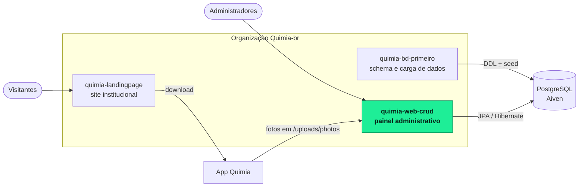
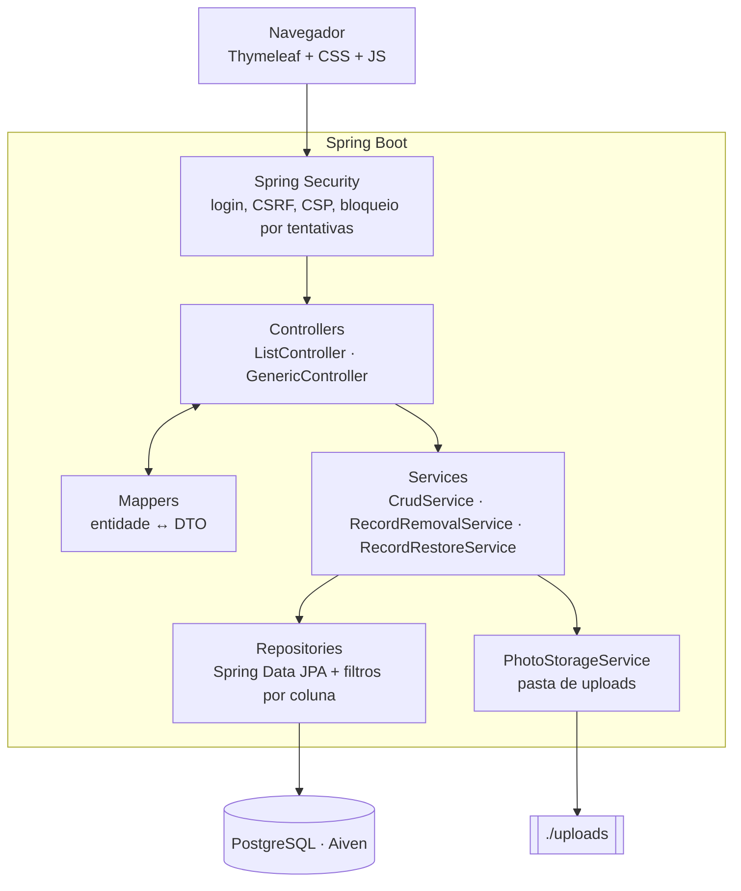
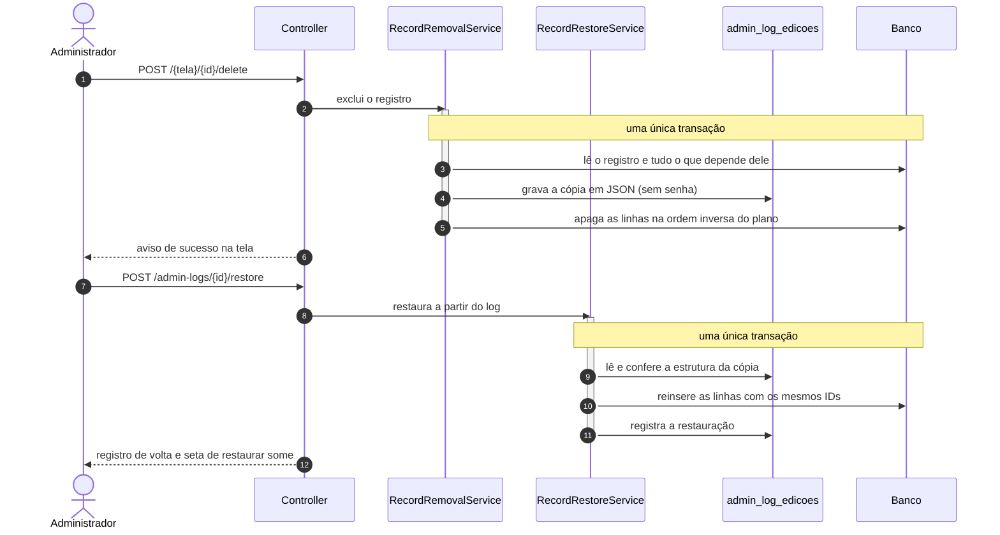
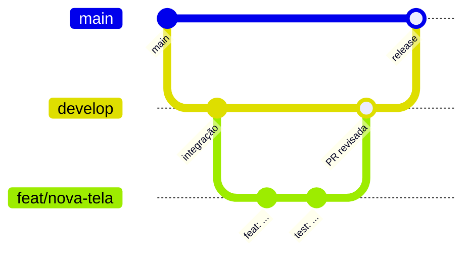

<a id="top"></a>

<div align="center">


# Quimia · Painel Administrativo

**Painel web para administrar os dados do Quimia: usuários, empresas, produtos, estantes, históricos e descartes, com auditoria completa e restauração de exclusões.**

[](https://openjdk.org/projects/jdk/25/)
[](https://spring.io/projects/spring-boot)
[](https://spring.io/projects/spring-security)
[](https://www.thymeleaf.org/)
[](https://aiven.io/postgresql)
[](https://maven.apache.org/wrapper/)

[](https://github.com/Quimia-br/quimia-web-crud/actions/workflows/update_dashboard_mv.yml)
[&style=flat-square)](https://github.com/Quimia-br/quimia-web-crud/commits/develop)
[](https://github.com/Quimia-br/quimia-web-crud/pulls?q=is%3Apr+is%3Aclosed)
[](https://github.com/Quimia-br/quimia-web-crud)

[Funcionalidades](#funcionalidades) ·
[Arquitetura](#arquitetura) ·
[Começando](#começando) ·
[Testes](#testes) ·
[Contribuindo](#contribuindo)

</div>

---

## Sumário

- [Sobre](#sobre)
- [O ecossistema Quimia](#o-ecossistema-quimia)
- [Funcionalidades](#funcionalidades)
- [Telas e rotas](#telas-e-rotas)
- [Arquitetura](#arquitetura)
- [Exclusão e restauração](#exclusão-e-restauração)
- [Dashboard](#dashboard)
- [Segurança](#segurança)
- [Começando](#começando)
- [Testes](#testes)
- [Automação (GitHub Actions)](#automação-github-actions)
- [Estrutura do projeto](#estrutura-do-projeto)
- [Contribuindo](#contribuindo)
- [Equipe](#equipe)
- [Repositórios relacionados](#repositórios-relacionados)

## Sobre

O **Quimia** é um aplicativo que ajuda a evitar misturas perigosas de produtos de limpeza: o usuário monta a estante de produtos da casa, registra usos, misturas e descartes, e recebe orientações de segurança. As empresas parceiras cadastram os próprios produtos e acompanham dados de uso.

Este repositório é o **painel administrativo** do Quimia: uma aplicação Spring Boot com telas renderizadas no servidor (Thymeleaf), em que os administradores consultam, cadastram, editam e excluem os registros do banco, com cada alteração registrada em log e qualquer exclusão podendo ser desfeita.

> [!NOTE]
> O painel não cria nem altera tabelas (`spring.jpa.hibernate.ddl-auto=validate`). O schema do banco vem do repositório [`quimia-bd-primeiro`](https://github.com/Quimia-br/quimia-bd-primeiro), e a aplicação só sobe se as entidades baterem com o banco real.

<p align="right"><a href="#top">voltar ao topo</a></p>

## O ecossistema Quimia



<p align="right"><a href="#top">voltar ao topo</a></p>

## Funcionalidades

| Área | O que o painel faz |
|---|---|
| **Dashboard** | Totais, alertas de contas bloqueadas ou pendentes, últimas ações dos administradores, rankings e gráficos em SVG gerados no servidor, com seletor de período (7, 30 ou 90 dias) |
| **Cadastros** | Criação e edição em popups, com validação no formulário (instantânea) e no servidor (Bean Validation + regras de negócio) |
| **Listas** | Filtros por coluna, paginação no servidor e tela de detalhes de cada registro |
| **Ações em massa** | *Atualizar por...* e *Apagar por...*: altera ou exclui todos os registros em que uma coluna tem determinado valor, numa única transação |
| **Exclusão em cascata** | Ao excluir um registro, apaga junto tudo o que depende dele, guardando antes uma cópia completa no log |
| **Restauração** | Desfaz uma exclusão a partir do log, reinserindo as linhas com os mesmos IDs |
| **Auditoria** | Toda criação, edição e exclusão feita pela tela entra em `admin_log_edicoes`, com o administrador responsável e o dado anterior (nunca a senha) |
| **Fotos** | Upload de foto para usuários e empresas, validado pelo conteúdo real do arquivo e regravado pelo servidor |
| **Interface** | Menu lateral recolhível que pode ser fixado (a escolha fica salva no navegador), alertas, badges de status e página de erro própria |

<p align="right"><a href="#top">voltar ao topo</a></p>

## Telas e rotas

Todas as rotas exigem login, exceto `/login`, os arquivos estáticos e as fotos.

| Rota | Tabela no banco | Tipo de tela |
|---|---|---|
| `/` | `mv_dashboard` (view materializada) | Dashboard |
| `/users` | `usuarios` | Cadastro |
| `/companies` | `usuarios_empresas` | Cadastro |
| `/products` | `produtos` | Cadastro |
| `/disposals` | `descartes_fds` | Cadastro |
| `/history-types` | `tipos_historicos` | Cadastro |
| `/admins` | `admins` | Cadastro |
| `/histories` | `historicos` | Consulta |
| `/shelves` | `estantes` | Consulta |
| `/locations` | `localizacoes` | Consulta |
| `/admin-logs` | `admin_log_edicoes` | Consulta, com restauração |

<details>
<summary><b>Rotas de escrita das telas de cadastro</b></summary>

<br>

Todas as rotas abaixo são `POST`, protegidas por token CSRF, e ficam sob o prefixo de cada tela (por exemplo `/products/save`).

| Rota | Ação |
|---|---|
| `/{tela}/save` | Cria ou edita um registro |
| `/{tela}/{id}/delete` | Exclui o registro e o que depende dele |
| `/{tela}/update-by` | Atualiza em massa os registros com determinado valor numa coluna |
| `/{tela}/delete-by` | Exclui em massa os registros com determinado valor numa coluna |
| `/admin-logs/{id}/restore` | Restaura uma exclusão registrada no log |
| `/dashboard/refresh` | Recalcula a view do dashboard |
| `/logout` | Encerra a sessão |

</details>

<p align="right"><a href="#top">voltar ao topo</a></p>

## Arquitetura

A aplicação segue uma arquitetura em camadas, com controllers e services genéricos reaproveitados por todas as telas.



| Pacote | Responsabilidade |
|---|---|
| `controller` | `ListController` (lista com filtros e paginação) e `GenericController` (salvar, excluir e ações em massa), estendidos por cada tela |
| `service` | Regras de negócio, log de edições, exclusão em cascata, restauração, fotos e cálculo dos gráficos do dashboard |
| `repository` | Repositórios Spring Data JPA, filtro dinâmico por coluna (`ColumnFilterRepository`) e leitura nativa da `mv_dashboard` |
| `model` | Entidades JPA mapeadas para as tabelas em português, enums dos `CHECK` do banco e chaves compostas |
| `dto` / `mapper` | Objetos de entrada e saída das telas, com validação, e a conversão entre eles e as entidades |
| `security` | Configuração do Spring Security, hash Argon2id, carregamento do administrador e bloqueio por tentativas |
| `exception` | Exceções de negócio e o `GlobalExceptionHandler`, que transforma erros em avisos na tela ou na página de erro |
| `config` | Relógio injetável (`Clock`) e configuração do JPA |

<p align="right"><a href="#top">voltar ao topo</a></p>

## Exclusão e restauração

O banco não permite apagar um registro que ainda é referenciado. Por isso cada tela tem um **plano de exclusão**: a lista de tabelas afetadas, na ordem em que as linhas podem ser reinseridas. Antes de apagar, o painel guarda uma cópia de todas as linhas no log; é essa cópia que permite restaurar.



> [!IMPORTANT]
> Se qualquer passo falhar (por exemplo, o e-mail do registro já foi usado por outro), nada é apagado ou restaurado. As fotos apagadas junto com o registro não voltam na restauração.

<p align="right"><a href="#top">voltar ao topo</a></p>

## Dashboard

A tela inicial lê tudo de uma única consulta à **view materializada `mv_dashboard`**, que já traz totais, alertas, últimas atividades, séries por dia e por mês e rankings. O `DashboardService` separa as seções, compara os períodos e desenha os gráficos em SVG no servidor.

| Como a view é atualizada | Detalhe |
|---|---|
| Automaticamente, a cada 2 horas | Workflow do GitHub Actions (ver [Automação](#automação-github-actions)) |
| Pelo botão de atualizar no dashboard | `POST /dashboard/refresh`, com `REFRESH MATERIALIZED VIEW CONCURRENTLY`, para quem estiver com o dashboard aberto continuar lendo a versão anterior; um segundo clique durante a atualização é recusado |

> [!WARNING]
> A definição SQL da `mv_dashboard` não está versionada neste repositório nem no `quimia-bd-primeiro`. Ela precisa existir no banco, com um índice único (exigido pelo `CONCURRENTLY`) e pertencer ao usuário que a aplicação usa. Vale guardar o script dela no repositório do banco.

<p align="right"><a href="#top">voltar ao topo</a></p>

## Segurança

<details open>
<summary><b>Medidas implementadas</b></summary>

<br>

| Medida | Como funciona |
|---|---|
| **Login obrigatório** | Todas as telas exigem administrador autenticado; só ficam abertos o login, os arquivos visuais e as fotos |
| **Hash Argon2id** | Senhas guardadas com `Argon2PasswordEncoder`, num único ponto do sistema (`PasswordHasher`) |
| **Bloqueio por tentativas** | 5 erros seguidos bloqueiam a conta por 15 minutos (contadores em memória) |
| **Contas inativas** | Só administradores com status `ATIVO` entram |
| **CSRF** | Proteção ligada; os formulários Thymeleaf enviam o token, e o logout só funciona por `POST` |
| **Content Security Policy** | Scripts só do próprio site, sem `iframe` de terceiros (`frame-ancestors 'none'`) e formulários só para o próprio domínio |
| **Cookie de sessão** | `HttpOnly`, `SameSite=Lax`, expira em 30 minutos e fica `Secure` com `SESSION_COOKIE_SECURE=true` |
| **Upload de fotos** | Formato identificado pelos primeiros bytes (não pela extensão), limite de 2 MB e 4096 px por lado, imagem decodificada e regravada (descarta metadados e conteúdo escondido) e nome aleatório |
| **URLs de foto** | Só endereços `http(s)` sem caracteres perigosos ou fotos do próprio sistema viram `src` de imagem; `javascript:` e `data:` são ignorados |
| **Ações em massa** | A coluna escolhida precisa ser uma das oferecidas pela tela, porque o nome vai para o SQL |

</details>

<p align="right"><a href="#top">voltar ao topo</a></p>

## Começando

### Pré-requisitos

| Ferramenta | Versão |
|---|---|
| JDK | 25 |
| Maven | não precisa instalar: o projeto usa o Maven Wrapper (`mvnw`) |
| Banco | PostgreSQL com o schema do [`quimia-bd-primeiro`](https://github.com/Quimia-br/quimia-bd-primeiro) e a view `mv_dashboard` |

### 1. Clonar

```bash
git clone https://github.com/Quimia-br/quimia-web-crud.git
cd quimia-web-crud
git switch develop
```

### 2. Configurar o `.env`

A aplicação lê um arquivo `.env` na raiz do projeto (formato `CHAVE=valor`), que fica fora do Git.

```properties
DATABASE_URL=jdbc:postgresql://<host>:<porta>/defaultdb?sslmode=require
DATABASE_USER=<usuario>
DATABASE_PASSWORD=<senha>
```

| Variável | Obrigatória | Padrão | Para quê |
|---|:---:|---|---|
| `DATABASE_URL` | sim | | URL JDBC do PostgreSQL (no Aiven, a porta não é a 5432) |
| `DATABASE_USER` | sim | | Usuário do banco |
| `DATABASE_PASSWORD` | sim | | Senha do banco |
| `UPLOAD_DIR` | não | `./uploads` | Pasta onde as fotos enviadas são gravadas |
| `PUBLIC_BASE_URL` | não | `http://localhost:8080` | Endereço público usado para montar a URL das fotos |
| `SESSION_COOKIE_SECURE` | não | `false` | Use `true` em produção com HTTPS |

> [!CAUTION]
> Nunca faça commit do `.env`. Ele já está no `.gitignore`; se ele aparecer no `git status`, pare e confira antes de continuar.

### 3. Rodar

<table>
<tr><th>Windows (PowerShell)</th><th>Linux / macOS</th></tr>
<tr>
<td>

```powershell
.\mvnw.cmd spring-boot:run
```

</td>
<td>

```bash
./mvnw spring-boot:run
```

</td>
</tr>
</table>

Depois abra <http://localhost:8080> e entre com um administrador cadastrado.

### 4. Criar o primeiro administrador

O painel não tem tela de cadastro aberta e a carga de dados deixa a tabela `admins` vazia, então o primeiro administrador é inserido direto no banco.

<details>
<summary><b>Passo a passo</b></summary>

<br>

1. Gere o hash Argon2id da senha. Com o ambiente do `quimia-bd-primeiro` instalado:

   ```bash
   uv run python -c "from pwdlib import PasswordHash; print(PasswordHash.recommended().hash('SUA-SENHA'))"
   ```

   O hash carrega os próprios parâmetros, então o Spring Security consegue conferi-lo.

2. Insira o administrador:

   ```sql
   INSERT INTO admins (nome, email, senha_hash, status)
   VALUES ('Seu Nome', 'voce@exemplo.com', '<hash gerado>', 'ATIVO');
   ```

3. Entre no painel com esse e-mail e senha. Os próximos administradores podem ser cadastrados pela tela `/admins`.

</details>

<p align="right"><a href="#top">voltar ao topo</a></p>

## Testes

A suíte tem mais de 160 testes (JUnit 5, `@WebMvcTest`, `@SpringBootTest` e Spring Security Test) e **não precisa de banco**: as entidades, rotas, formulários, filtros, exclusão, restauração, fotos e segurança são testados com o contexto do Spring isolado.

```bash
./mvnw test
```

<details>
<summary><b>Verificação contra o banco real</b></summary>

<br>

O teste `RealDatabaseRestoreCheckTest` usa o banco do `.env`: exclui um registro de cada tipo, restaura e confere que as linhas voltaram idênticas. A transação é sempre revertida, então o banco não muda. Ele só roda quando a variável `QUIMIA_REAL_DB_CHECK` vale `1`:

```powershell
# PowerShell
$env:QUIMIA_REAL_DB_CHECK = "1"; .\mvnw.cmd test -Dtest=RealDatabaseRestoreCheckTest
```

```bash
# Linux / macOS
QUIMIA_REAL_DB_CHECK=1 ./mvnw test -Dtest=RealDatabaseRestoreCheckTest
```

</details>

<p align="right"><a href="#top">voltar ao topo</a></p>

## Automação (GitHub Actions)

| Workflow | Quando roda | O que faz |
|---|---|---|
| [`update_dashboard_mv.yml`](https://github.com/Quimia-br/quimia-web-crud/blob/main/.github/workflows/update_dashboard_mv.yml) | A cada 2 horas e manualmente (*Run workflow*) | Executa `REFRESH MATERIALIZED VIEW mv_dashboard` no banco do Aiven |

O workflow usa os secrets `DB_HOST`, `DB_PORT`, `DB_USER` e `DB_PASSWORD`, configurados em *Settings → Secrets and variables → Actions*.

<p align="right"><a href="#top">voltar ao topo</a></p>

## Estrutura do projeto

<details>
<summary><b>Ver a árvore de pastas</b></summary>

<br>

```
quimia-web-crud/
├── .github/workflows/
│   └── update_dashboard_mv.yml    refresh da view do dashboard a cada 2 h
├── src/
│   ├── main/
│   │   ├── java/com/quimia/quimiawebcrud/
│   │   │   ├── config/            Clock e JPA
│   │   │   ├── controller/        telas (ListController, GenericController e uma por tabela)
│   │   │   ├── dto/               entrada e saída das telas, com validação
│   │   │   ├── exception/         exceções de negócio e tratador global
│   │   │   ├── mapper/            entidade ↔ DTO
│   │   │   ├── model/             entidades JPA, enums e chaves compostas
│   │   │   ├── repository/        Spring Data JPA, filtros e leitura da mv_dashboard
│   │   │   ├── security/          Spring Security, Argon2id e bloqueio por tentativas
│   │   │   └── service/           regras, log, exclusão, restauração, fotos e gráficos
│   │   └── resources/
│   │       ├── static/            css/, js/, icons/ e images/
│   │       ├── templates/         uma pasta por tela, mais fragments/ e error.html
│   │       └── application.properties
│   └── test/java/...              testes por camada (controller, service, repository, security)
├── mvnw / mvnw.cmd                Maven Wrapper
└── pom.xml
```

</details>

<p align="right"><a href="#top">voltar ao topo</a></p>

## Contribuindo



1. Parta sempre da `develop` atualizada e crie uma branch com prefixo do tipo: `feat/`, `fix/`, `refactor/`, `style/`, `test/`, `chore/`.
2. Escreva os commits em inglês, no padrão [Conventional Commits](https://www.conventionalcommits.org/) e no imperativo, por exemplo `feat(dashboard): add period selector to charts`.
3. Rode `./mvnw test` antes de abrir a PR.
4. Abra a PR para a `develop` e peça a revisão de alguém da equipe. Nada vai direto para a `main`.

> [!TIP]
> Uma tela nova costuma precisar de entidade em `model/`, DTOs e mapper, um service que estende `CrudService`, um controller que estende `GenericController` (ou `ListController`, se for só consulta) e o template em `templates/<tela>/list.html`. Os testes `ColumnFieldsMatchRepositoriesTest` e `FormAttributesTest` avisam se algo ficou desalinhado.

<p align="right"><a href="#top">voltar ao topo</a></p>

## Equipe

<a href="https://github.com/Quimia-br/quimia-web-crud/graphs/contributors">
  
</a>

Projeto desenvolvido para a **ExpoTech 2026**.

## Repositórios relacionados

| Repositório | Papel |
|---|---|
| [`quimia-bd-primeiro`](https://github.com/Quimia-br/quimia-bd-primeiro) | Schema do PostgreSQL e carga de dados (seed) |
| [`quimia-landingpage`](https://github.com/Quimia-br/quimia-landingpage) | Site institucional, publicado em [quimia.tech](https://quimia.tech) |

<p align="right"><a href="#top">voltar ao topo</a></p>
